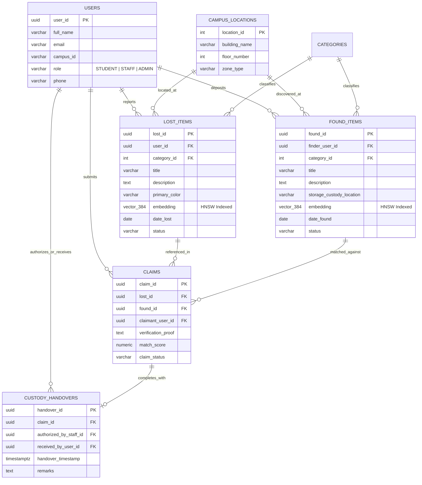

# Smart Campus Lost-and-Found Platform

[](https://www.postgresql.org/)
[](https://github.com/pgvector/pgvector)
[](https://nodejs.org/)
[](https://opensource.org/licenses/MIT)

A modern, high-throughput lost-and-found recovery platform engineered with **PostgreSQL 16** and the **`pgvector`** extension. The platform uses 384-dimensional dense semantic embeddings to automatically match unstructured human descriptions with physical items stored in secure campus custody lockers.

---

## Architecture Overview

Traditional lost-and-found portals rely on exact lexical keywords (`LIKE '%laptop%'`), which fail when different parties describe the same physical object using varied vocabulary (*"silver ultra-thin notebook"* vs. *"MacBook Air M2"*).

This platform implements a dual-engine architecture:

1. **Semantic Matching Engine (`pgvector`)**:
   - Converts natural language descriptions into 384-dimensional dense vector embeddings using `all-MiniLM-L6-v2`.
   - Executes Approximate Nearest Neighbor (ANN) vector search via **HNSW (Hierarchical Navigable Small World)** indexing.
   - Calculates dynamic cosine distance ($\text{Cosine Distance} = 1 - \frac{u \cdot v}{\|u\|_2 \|v\|_2}$) combined with location proximity and category heuristics.

2. **Transactional Custody Engine (PostgreSQL)**:
   - Uses multi-statement ACID transactions and row-level locking (`SELECT ... FOR UPDATE`) in `sp_execute_item_handover` to prevent race conditions and double-handover fraud.
   - Automatically maintains immutable audit logs via database triggers on status mutations.
   - Enforces referential integrity, state machine enums, and temporal invariants directly at the schema level.

---

## Entity-Relationship Architecture



---

## Core Database Subsystems

| Module | Implementation | Description |
| :--- | :--- | :--- |
| **Vector Engine** | `embedding vector(384)` with HNSW | Fast approximate nearest neighbor search utilizing cosine operator `<=>` with $m=16, ef=64$. |
| **Hybrid Matcher** | `fn_match_lost_item()` | In-database PL/pgSQL function computing composite scores (80% vector similarity + 15% location bonus + 5% category match). |
| **Atomic Handover** | `sp_execute_item_handover()` | Stored procedure running inside a single ACID boundary with row-level locks to atomically release custody. |
| **Audit Trigger** | `trg_audit_item_status` | Trigger capturing every transition of item lifecycle states into an append-only `item_audit_log` table. |
| **Hotspot Analytics** | `v_campus_loss_hotspots` | Aggregated view tracking incident frequencies, recovery rates, and zone vulnerabilities across campus buildings. |

---

## Quickstart

### Prerequisites
- Node.js v20+
- Docker & Docker Compose (Optional, for local PostgreSQL container)

### 1. Clone & Install
```bash
git clone https://github.com/<YOUR_USERNAME>/smart-campus-lost-and-found.git
cd smart-campus-lost-and-found
npm install
```

### 2. Run Application
```bash
# Start the local application runner
node server.js
```
Open **`http://localhost:3000`** in your browser.

---

## Database Initialization (Optional Local Docker)

If you wish to spin up a local PostgreSQL 16 container with `pgvector` pre-configured:

```bash
docker compose up -d
```

The container automatically mounts and executes the migration pipeline in `/database`:
1. `01_schema.sql` — Schema definitions, foreign keys, CHECK constraints, and HNSW indexes.
2. `02_views.sql` — Analytical views and claim queue views.
3. `03_functions_procedures.sql` — Stored procedures and vector match functions.
4. `04_triggers.sql` — Automated audit logging triggers.
5. `05_seed.sql` — Sample inventory and campus locations.

---

## Query Benchmarks & Analytics

To inspect complex analytical queries, refer to [`database/06_queries.sql`](database/06_queries.sql), which demonstrates:
- 4-Table relational joins for custody dossiers.
- Location grouping with `HAVING` filters and recovery rate computations.
- Correlated subqueries using `EXISTS` to identify candidate claim overlaps.
- Common Table Expressions (CTEs) combined with window ranking functions (`DENSE_RANK()`).

---

## License
Distributed under the MIT License. See `LICENSE` for more information.
